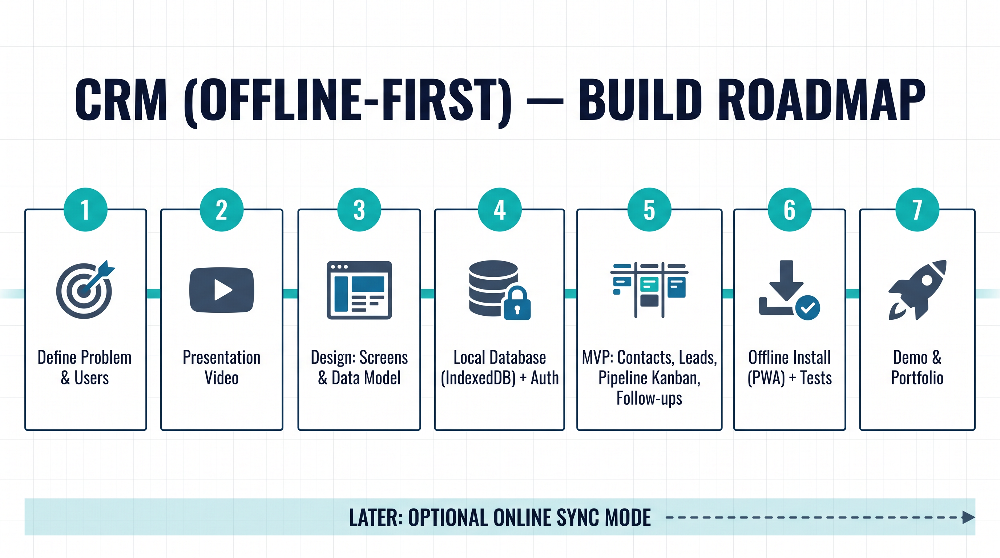

# پروژه ۰۱: CRM ساده (نسخه آفلاین‌اول)

- **حالت اصلی**: آفلاین‌اول (داده روی دستگاه، بدون نیاز به اینترنت)
- **حالت بعدی (اختیاری)**: همگام‌سازی آنلاین با سرور
- **مسئله**: فروشنده‌ها سرنخ و مشتری را در اکسل و واتساپ نگه می‌دارند و پیگیری گم می‌شود.

## نقشه راه

## وضعیت
- [x] نقشه راه تصویری
- [ ] ویدئو/اسلاید معرفی
- [ ] طراحی صفحات و مدل داده
- [ ] MVP آفلاین
- [ ] تست
- [ ] نسخه PWA قابل نصب
- [ ] دمو و اسکرین‌شات
- [ ] همگام‌سازی آنلاین (اختیاری)
